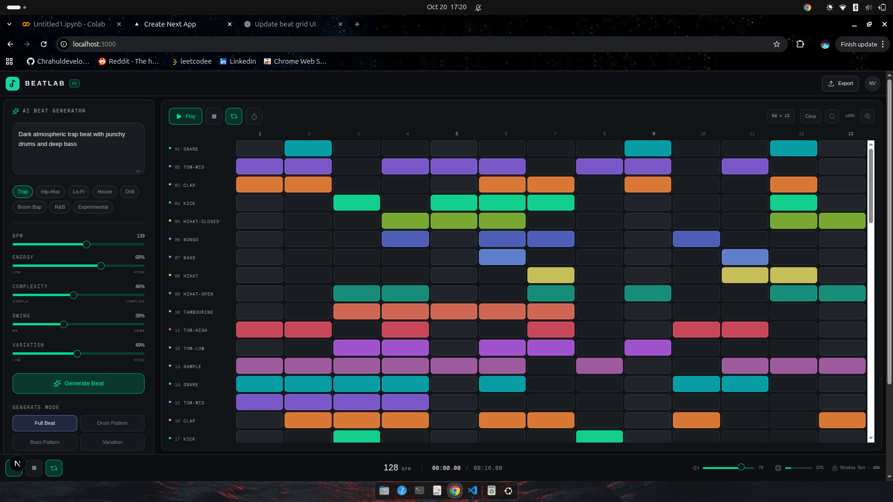

# 🎵 AI Beat & Music Generator

  

An AI-powered music creation tool that turns natural-language descriptions into beats. Generate rhythms, experiment with 13 instruments, and edit patterns using an interactive beat sequencer.

## ✨ Features

- 🤖 AI-powered beat generation from text descriptions
- 🥁 13 instruments for creating rhythms
- 🎛️ Interactive beat sequencer and pattern editing
- ▶️ Beat playback and arrangement
- 🎼 Song generation planned for future releases

## 🛠️ Tech Stack

- **Frontend:** Next.js, React, TypeScript
- **Backend:** Python, FastAPI
- **Machine Learning:** PyTorch

## 🚀 Getting Started

Set up the frontend and backend using their respective dependencies and environment configurations.

API documentation is available at `/docs` when the FastAPI backend is running.
